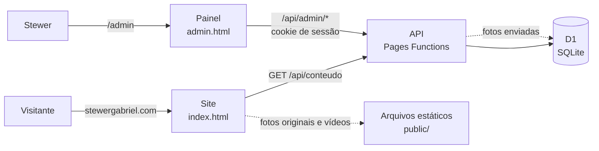
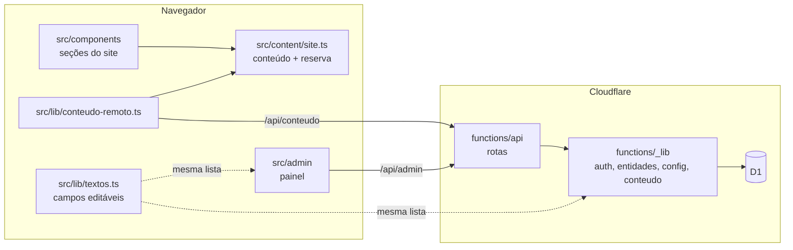
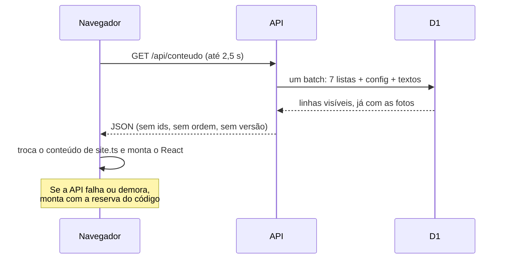
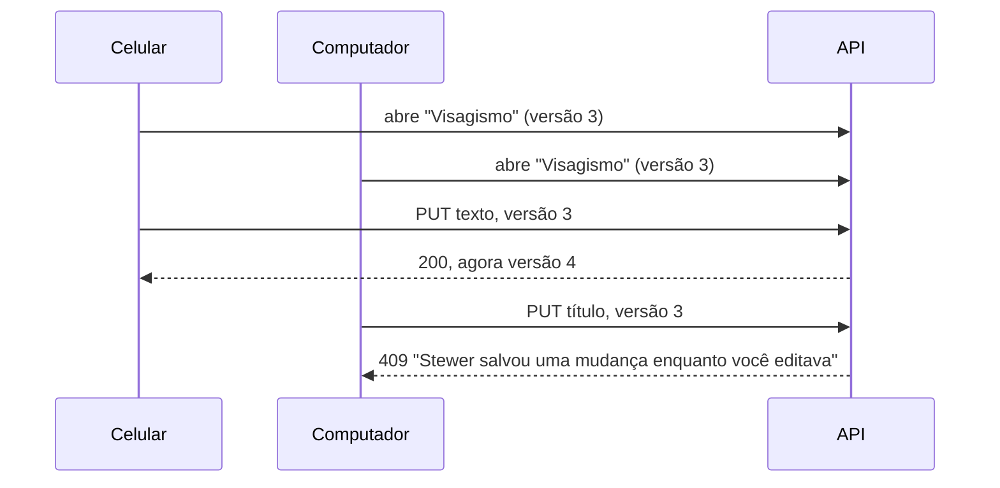

# Arquitetura · Stewer Gabriel

O site e o painel são um projeto só, publicado no Cloudflare Pages. O mesmo
deploy leva três coisas:

- o **site** (`index.html`, React + Vite + Tailwind), que é o que o cliente vê;
- o **painel** (`admin.html`, React), uma segunda entrada do build, em `/admin`;
- a **API** (`functions/`, TypeScript nas Pages Functions), que fala com o
  banco **D1** (SQLite gerenciado pela Cloudflare).

Tudo no plano gratuito. Não existe servidor ligado esperando: cada pedido à
API acorda uma função na borda da Cloudflare, que responde em milissegundos.

## Hospedagem e quem cuida de cada parte

| parte | onde fica | quem mexe |
|---|---|---|
| Código | GitHub (`Gustavo16378/stewer-site`) | o mantenedor |
| Site, painel e API | Cloudflare Pages, projeto do site | deploy automático a cada push na `main` |
| Banco | Cloudflare D1 `stewer-site` | o painel (conteúdo) e as migrations (estrutura) |
| Segredo das sessões | variável `JWT_SECRET` do Pages, tipo Secret | o mantenedor, uma vez |

## Camadas

- **`src/content/site.ts`** guarda todo o conteúdo do site, com o texto
  original como reserva. Os componentes só leem daqui.
- **`src/lib/conteudo-remoto.ts`** busca `/api/conteudo` antes do primeiro
  render e troca o conteúdo de `site.ts` no lugar.
- **`functions/_lib/entidades.ts`** descreve as sete listas (tabela, campos,
  limites). Uma rota só (`/api/admin/[entidade]`) atende todas.
- **`functions/_lib/config.ts`** valida contatos e coordenadas.
- **`functions/_lib/auth.ts`** cuida de senha (PBKDF2) e sessão (JWT).

## Uma fonte só para o que é compartilhado

`src/lib/textos.ts` é a lista de todos os textos fixos que podem ser
trocados: chave, seção, rótulo, tipo e limite. Três lugares usam a mesma
lista:

1. o **painel** monta a aba "Textos do site" a partir dela;
2. a **API** só aceita chaves que estão nela, com os limites dela;
3. o **site** aplica os valores salvos com a função `gravar` de cada campo.

Um campo novo entra num lugar e aparece nos três.

## Fluxo de leitura do site

Trocar o conteúdo antes do primeiro render, e não depois com estado, é de
propósito: o mapa e as animações de entrada leem o conteúdo uma vez, na
montagem. O resultado é que o site com o banco fica idêntico ao de antes,
pixel por pixel (conferido comparando capturas da página inteira no
computador e no celular).

## Fotos e vídeos

- **Fotos originais** continuam em `public/` e entram no banco só como
  endereço (`midias.caminho`). Não podem ser apagadas pelo painel.
- **Fotos novas** são reduzidas no navegador (até 1600px, WebP, até 1,4 MB)
  e guardadas dentro do D1 (`midias.dados`). A API entrega em
  `/api/midias/:id` com cache de um ano, porque o conteúdo de um id nunca
  muda: trocar a foto cria outro id.
- **Vídeos** ficam no código (`VIDEOS_PORTFOLIO` e `VIDEOS_AULAS`), porque não
  cabem numa linha do D1. O site intercala foto, vídeo, foto…

## Edição simultânea

Cada item de lista tem uma coluna `versao`. O painel manda a versão que
tinha quando abriu o item; a API grava com `WHERE versao = ?`. Se outra
pessoa salvou no meio, a gravação não acha a linha e a API responde 409
dizendo quem salvou antes. Ninguém perde a mudança do outro sem saber.

O interruptor "No site" não manda versão (vale o último), porque é uma
troca de um campo só e o resultado é sempre o que a pessoa vê.

## Segurança

- Senha: PBKDF2-SHA256, 100 mil iterações, salt por usuário. O hash é
  calculado igual na API e no script de criar acesso.
- Sessão: JWT HS256 no cookie `sg_sessao`, `HttpOnly`, `SameSite=Strict`,
  `Path=/api`, `Secure` em HTTPS, 8 horas.
- CSRF: além do `SameSite`, todo pedido que muda dados precisa vir da
  própria origem.
- Login trava por 15 minutos depois de 5 erros no mesmo e-mail.
- SQL: nomes de tabela e coluna só da lista fechada de `entidades.ts`;
  valores sempre por bind.
- Upload: tipo conferido pelos bytes, não pelo que o navegador diz. SVG é
  recusado (pode carregar script).
- Conteúdo: o React escapa todo texto; o único HTML montado à mão (o rótulo
  do marcador do mapa) passa por escape. Testado no E2E.

## Decisões

| decisão | por quê |
|---|---|
| Pages Functions + D1, não um back em Java ou Node num servidor | servidor gratuito dorme e demora quase um minuto para acordar; aqui o custo é zero e a resposta é imediata |
| Mesmo repositório e mesmo deploy do site | um push publica tudo junto; sem CORS, sem segundo domínio |
| Fotos no D1, não no R2 | o R2 pede cartão cadastrado na conta; foto reduzida cabe numa linha |
| Vídeos no código | não cabem no D1; o Stewer posta vídeo bem menos que foto |
| Conteúdo trocado antes do render | mantém o site idêntico ao original, sem piscar |
| Painel com a identidade do site | o Stewer reconhece a própria marca; o painel não parece um sistema genérico |
| Uma rota para as sete listas | as regras de cada campo moram num lugar só e são testadas uma vez |
