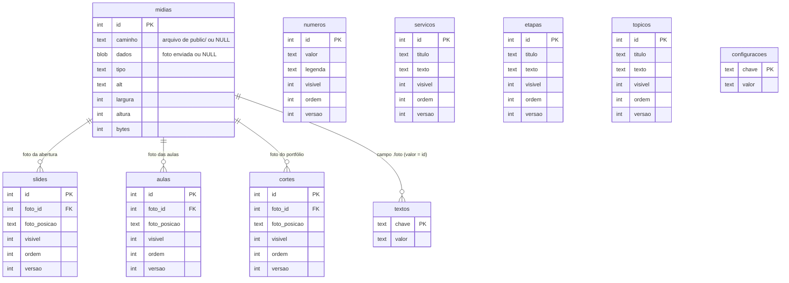
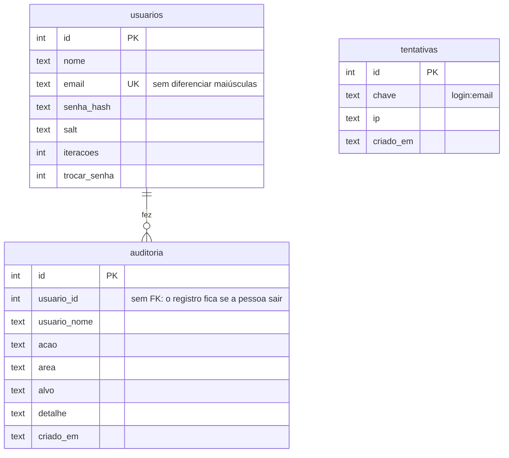

# Modelo do banco · Stewer Gabriel

Cloudflare D1 (SQLite). O esquema está em
[`migrations/0001_schema.sql`](../migrations/0001_schema.sql) e o conteúdo
inicial em [`migrations/0002_seed.sql`](../migrations/0002_seed.sql), gerado
por [`scripts/gerar-seed.ts`](../scripts/gerar-seed.ts).

## Diagrama entidade-relacionamento

### Conteúdo do site



`textos` aponta para `midias` só nas chaves que terminam em `.foto`, sem
chave estrangeira (o valor é texto). Por isso a API confere a foto antes de
gravar e conta esse uso antes de deixar apagar uma foto.

### Painel e operação



## Tabelas

| tabela | o que guarda | aparece no site em |
|---|---|---|
| `midias` | toda foto, original ou enviada | onde for usada |
| `slides` | fotos que se revezam na abertura | topo |
| `numeros` | +800 clientes, 10+ anos… | Quem é |
| `servicos` | cards numerados | Serviços |
| `etapas` | itens da consultoria | Consultoria |
| `topicos` | o que se aprende | Ensino |
| `aulas` | galeria dos bastidores | Ensino |
| `cortes` | fotos do portfólio | Portfólio |
| `textos` | textos e fotos fixos trocados no painel | todas as seções |
| `configuracoes` | `whatsapp`, `instagram`, `mensagem`, `latitude`, `longitude` | botões, contato, mapa |
| `usuarios` | quem entra no painel | não aparece |
| `tentativas` | freio de login | não aparece |
| `auditoria` | quem fez o quê | não aparece |

## Regras que o próprio banco garante

Mesmo que a API tivesse um bug, o banco recusa:

- `visivel` e `trocar_senha` fora de 0 e 1 (CHECK);
- foto sem arquivo e sem bytes, ou com dimensão zero (CHECK);
- item de lista de foto sem foto (NOT NULL) ou apontando para foto que não
  existe (FOREIGN KEY);
- apagar uma foto em uso por uma lista (FOREIGN KEY com RESTRICT);
- e-mail repetido, sem diferenciar maiúsculas (UNIQUE com NOCASE);
- ação de auditoria fora da lista (CHECK).

## Migrations

| arquivo | o que faz |
|---|---|
| `0001_schema.sql` | cria todas as tabelas e índices |
| `0002_seed.sql` | conteúdo que já estava no site, gerado do código |

Regra de ouro (detalhada no [CONTRIBUTING](../CONTRIBUTING.md#banco)):
**migration nova nunca altera uma antiga** e é aplicada em produção antes do
código que depende dela entrar na `main`.

```bash
npm run db:local    # banco de desenvolvimento (.wrangler/)
npm run db:remoto   # produção
```

## Capacidade

O plano gratuito do D1 aceita 500 MB por banco. Quase todo o peso são as
fotos enviadas, cerca de 0,3 MB cada depois da redução: dá espaço para mais
de mil fotos. Texto quase não ocupa. As tentativas de login com mais de um
dia são apagadas a cada login, e a auditoria guarda um ano. O painel mostra
o uso em "Minha conta" e avisa no topo a partir de 70%.
